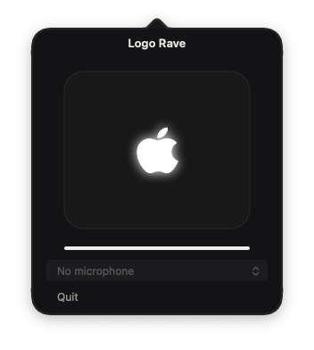

# Logo Rave

The glowing Apple logo on your MacBook, driven by the room.



Play music on a speaker. The lid logo brightens with it. Logo Rave listens to the microphone, not to audio the Mac itself is playing, so a Bluetooth speaker, a phone, or a party in the room all work.

Click the apple in the menu bar to pick a microphone. Right-click it and choose Quit. Closing the panel does not stop the light.

## You need

- A MacBook with the lit lid logo. That is the 14-inch and 16-inch Pro models that still glow.
- macOS 14 or later.
- A microphone. The built-in one is fine.

A Mac mini, a Mac Studio, and older MacBooks with a dark lid logo have nothing for this app to drive.

## Install

```
git clone https://github.com/zhast/logo-rave.git
cd logo-rave
make
open "Logo Rave.app"
```

The first time you open it, macOS will refuse a normal double-click. Right-click the app, choose Open, then Open again. Allow the microphone when asked.

If you already run [LogoLight](https://github.com/Ark0N/LogoLight), quit it first. Both apps write to the same logo, and they fight.

## Use

The apple sits in the menu bar.

- Click it to choose the microphone and watch the level. The built-in microphone is preferred for room audio; this does not change macOS input/output settings.
- Audio route changes rebuild capture, stale samples decay to silence, and the panel reports when input is unavailable.
- Uncheck **Light enabled** to hold the logo off and stop microphone capture. Check it again to resume. This is a session-only switch; quitting still restores normal logo behavior.
- Right-click it and choose Quit when you want the logo back to normal.
- Louder room, brighter logo. Quiet room, it fades back down.

## Build it yourself

```
make
make test
```

`make` writes `Logo Rave.app` in this folder and signs it so your Mac can open it. `make test` checks the level math without touching the logo.

## How it hears the room

The microphone tap measures how loud the room is. That level is smoothed, then sent to the logo through the private CoreBrightness API that also drives the keyboard backlight. The same approach is what LogoLight uses. It is private API, so a macOS update can break it.

The light follows loudness. It does not try to guess the tempo.

## License

MIT. See [LICENSE](LICENSE).

## Xcode debugging

Open `Logo Rave.xcodeproj`, select the **Logo Rave** scheme and **My Mac**, then Run (⌘R). Debug builds include symbols and disable Swift optimization. The original Makefile build remains available.

To investigate an unexpected exit, set symbolic breakpoints on `-[NSApplication terminate:]`, `objc_exception_throw`, and `abort`. A normal termination is not an OS crash; capture the caller stack before attributing its cause.

Icon artwork uses configured SF Symbols with aspect-fit geometry. Run `make icon` to regenerate all icon resolutions; both Makefile and Xcode builds include the resulting AppIcon.icns.
